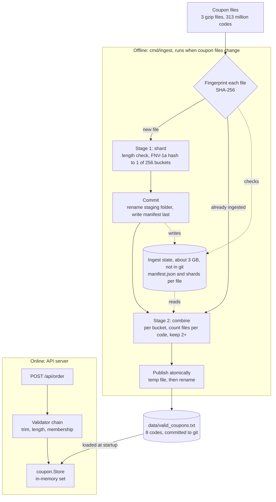

# Food ordering API in Go

A Go implementation of the [Oolio kart challenge](https://github.com/oolio-group/kart-challenge/blob/advanced-challenge/backend-challenge/README.md)
backend: the three endpoints of the [OpenAPI spec](https://github.com/oolio-group/kart-challenge/blob/b45fbd09b5499d4a2be823d399f6f494c6fbae8d/api/openapi.yaml),
with coupon validation over about 313 million coupon codes.

Every design decision, with its reasoning, is recorded in [DECISIONS.md](DECISIONS.md).

## Quick start

```sh
docker compose up --build
```

Then, in another terminal:

```sh
curl localhost:8080/api/product
curl localhost:8080/api/product/1

curl -X POST localhost:8080/api/order \
  -H 'api_key: apitest' -H 'Content-Type: application/json' \
  -d '{"couponCode":"HAPPYHRS","items":[{"productId":"1","quantity":2}]}'
```

The demo API keys are `apitest`, which can place orders, and `readonly`,
which can't (it shows the 403 case).

Without Docker, with Go 1.22 or newer: `make run` starts the server and
`make test` runs every test with the race detector.

## API

| Method | Path | Auth | Success | Errors |
| --- | --- | --- | --- | --- |
| GET | `/api/product` | none | 200, the menu | |
| GET | `/api/product/{productId}` | none | 200, one product | 400 invalid ID, 404 not found |
| POST | `/api/order` | `api_key` with the `create_order` scope | 200, the order | 400, 401, 403, 413, 422, 503 |

Every error uses the spec's `ApiResponse` shape, so clients handle one error
format. Clients should branch on `type`; `message` is for people.

```json
{ "code": 422, "type": "invalid_coupon", "message": "invalid coupon code" }
```

| Status | When | `type` |
| --- | --- | --- |
| 400 | The request can't be read: malformed JSON, wrong types, missing required fields, or a path ID that can never be valid (`abc`, `0`, `-1`) | `invalid_input`, `invalid_id` |
| 401 | No `api_key` header, or an unknown key | `unauthorized` |
| 403 | A known key without the `create_order` scope | `forbidden` |
| 404 | No product with that ID, or no such endpoint | `not_found` |
| 413 | The order body is over 16 KB | `payload_too_large` |
| 422 | Well-formed but breaks a rule | `no_items`, `too_many_items`, `invalid_quantity`, `unknown_product`, `invalid_coupon` |
| 503 | The coupon could not be checked; the order is not accepted unchecked | `coupon_unavailable` |

**Order rules**
- Up to 50 lines per order, each with a quantity of at least 1. Lines for the
  same product are merged, and the merged quantity can be at most 100.
- An unknown product rejects the whole order; there are no partial orders.
- `products` in the response is a copy of each product as it was when the
  order was placed, so later menu changes don't rewrite past orders.
- A missing, empty or blank `couponCode` means no coupon. Surrounding spaces
  are removed; otherwise codes match exactly, case included.
- Unknown JSON fields are ignored, so newer clients don't break.

## Coupon validation

A code is valid if it is 8 to 10 characters long and appears in at least 2
of the 3 coupon files. Both numbers are settings.

**What the data showed**

| | File 1 | File 2 | File 3 |
| --- | --- | --- | --- |
| Compressed size | 625 MB | 696 MB | 704 MB |
| Unique codes of 8 to 10 characters | 107,258,700 | 107,260,726 | 98,566,151 |

Only **8 codes** appear in two or more files. Some codes repeat inside a
single file (about 2,000 in file 1), and those must count as one file, not
two.

### Why an offline ingest step

- Scanning 3 GB of compressed text on every order takes minutes.
- Holding all 313 million codes in a Go map would need well over 10 GB.
- Validity depends on all three files at once, so it can't be decided from
  one file.

So the work is split. An offline tool, `cmd/ingest`, builds the list of valid
codes once. The server loads that small list into memory, and a lookup takes
nanoseconds.

### The flow



### How ingest works: hash partitioning in two stages

1. **Shard.** Each new file is fingerprinted with SHA-256, then read once.
   Every line is taken exactly as written and length-checked; lines of the
   wrong length are skipped and counted, never cleaned up. Each code is
   appended to one of 256 bucket files chosen by a stable hash (FNV-1a). The
   same code always lands in the same bucket, whichever file it came from.
2. **Combine.** Bucket by bucket, count how many different files each code
   appears in, and publish the codes found in at least 2 files.

Because every occurrence of a code is in the same bucket, each bucket can be
counted on its own and then discarded, so memory only ever holds one bucket.

**Guarantees**
- **Each file is read once, ever.** A file's shards are kept, so adding a
  fourth file reads only that file. Rerunning with all files skips known files
  after a quick fingerprint, a second or two each.
- **A renamed copy counts once.** Files are identified by their fingerprint in
  `state/manifest.json`, not by name.
- **Memory is set by the bucket count, not by file size.** Doubling the
  buckets splits each bucket into exactly two, without rereading the source
  files.
- **A crash or a bad file is never counted.** Files are sharded into a staging
  folder and committed by renaming it, and the manifest is written last.
  Truncated and non-gzip files fail before the commit.
- **The published list is replaced atomically.** A failed run leaves the
  previous list in place.

**Measured**

| Run | Codes | Time | Peak memory |
| --- | --- | --- | --- |
| The real files | 313 million | 2 min 48 s | 146 MB |
| Generated test data, 2 CPU cores | 30 million | 11 s | 110 MB |

On both, the output was identical to an independent shell pipeline
(`sort -u` on each file, then `sort -m | uniq -d`).

**Rerunning it**

```sh
make ingest   # or:
go run ./cmd/ingest -state ~/oolio-data/state couponbase1.gz couponbase2.gz couponbase3.gz
```

The output, `data/valid_coupons.txt`, is committed, so `docker compose up`
needs no 2 GB download. The ingest state (about 3 GB of shards) is kept out
of git.

**Alternatives considered**

| Approach | Why not |
| --- | --- |
| Load every code into one map | Over 10 GB of memory |
| External sort and merge | Slower, and an on-disk sort is more code; used here only as the independent check |
| Bloom filters | They answer "maybe", and every "maybe" must be confirmed: two reads of every file, and memory that grows with the data |
| Load everything into a database | Slow to load 313 million rows, and heavy on disk |

## Design

```
cmd/server        API server: config from environment, timeouts, graceful shutdown
cmd/ingest        offline coupon ingest tool
internal/api      HTTP layer: routing, JSON to and from domain types, errors, API key check
internal/order    order rules (limits, merging, coupon check) and order storage
internal/product  the menu
internal/coupon   coupon rule, coupon store, validator chain
internal/auth     API keys and scopes
internal/ingest   two-stage coupon ingest
data/             the menu and the published list of valid coupons
```

- **Handlers only translate.** Business rules live in the domain packages, so
  they're tested without HTTP.
- **Every dependency is an interface:** `product.Repository`,
  `order.Repository`, `coupon.Store` and `auth.KeyStore`. Storage can change
  without touching the code that uses it. `coupon.Store` already takes a
  `context` and returns an `error`, which the in-memory version never uses, so
  a networked store can replace it without changing any caller.
- **API types are separate from domain types.** The API sends IDs as strings
  and prices as decimals, as the spec defines. The domain keeps `int64` IDs
  and prices in minor units (1250 means 12.50), so money arithmetic is exact.
- **Coupon rules are a chain of checks**, cheapest first: length, then
  membership. Expiry dates, usage limits or a minimum order value would each
  be one more check.
- **Standard library only.**

## Scaling and extensibility

| Area | Today | Next step |
| --- | --- | --- |
| Menu reads | In memory, `Cache-Control: max-age=60` | A CDN in front, and a database behind a cache |
| Valid coupon list | In-memory set | Packed 64-bit codes in a sorted array, or a memory-mapped file; beyond one machine, Redis or Postgres with an in-process cache. Versioned lists in S3, reloaded without restart |
| Coupon files | 3 files, one machine, a few minutes | More buckets as data grows; shards in S3 with Stage 1 and Stage 2 run across machines (map and reduce) |
| Orders | In memory, lost on restart | A database, then horizontal scaling behind a load balancer |
| Duplicate orders on retry | Possible | An `Idempotency-Key` header |
| Rate limiting | Not in the app | At the gateway, where all instances share it |

For the coupon list in memory: a Go map costs about 40 bytes per code (about
400 MB at 10 million codes), and packed numbers cost 8 bytes per code.

## Configuration

| Variable | Default | Meaning |
| --- | --- | --- |
| `ADDR` | `:8080` | Listen address |
| `API_KEYS` | none | `secret:scope+scope`, comma-separated, e.g. `apitest:create_order,readonly:` |
| `PRODUCTS_FILE` | `data/products.json` | The menu |
| `COUPONS_FILE` | `data/valid_coupons.txt` | Valid codes from `cmd/ingest` |
| `ORDER_MAX_LINES` | 50 | Lines per order |
| `ORDER_MAX_QUANTITY` | 100 | Quantity per product |
| `ORDER_MAX_BODY_BYTES` | 16384 | Largest order body |
| `LOG_FORMAT` | `json` | `json` or `text` |

The server checks every file at startup and refuses to start if one is
missing or invalid, rather than failing requests later.

## Trade-offs

- About 3 GB of disk for shards, in exchange for low memory.
- New coupon files go live only after ingest reruns. Until then a new coupon
  may be rejected, but an invalid coupon is never accepted.
- Orders live in memory and are lost on restart.
- Without an idempotency key, a retried request can create a second order.

## Open questions

- Should coupon codes ignore case? The data is all uppercase, so it changes no
  result today; codes are matched exactly until decided.
- With more coupon files, should the rule stay "at least 2"?
- What does a coupon do? The spec's `Order` has no total or discount, so
  coupons are validated and recorded. Prices are already in minor units, ready
  for totals.
- nginx drops headers with underscores by default, which would drop
  `api_key`. Behind nginx, set `underscores_in_headers on;`.

## Not built, on purpose

A frontend, pagination (the spec returns a plain array), a database, an
idempotency key and rate limiting. Each is described above as a next step.
